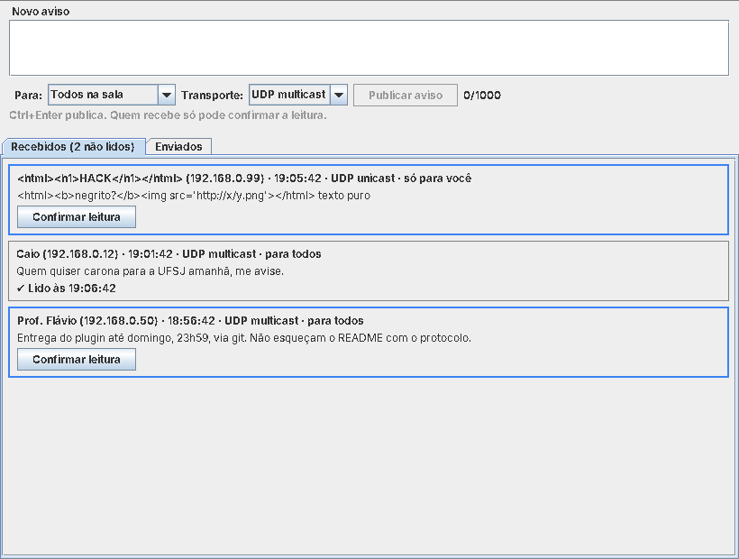
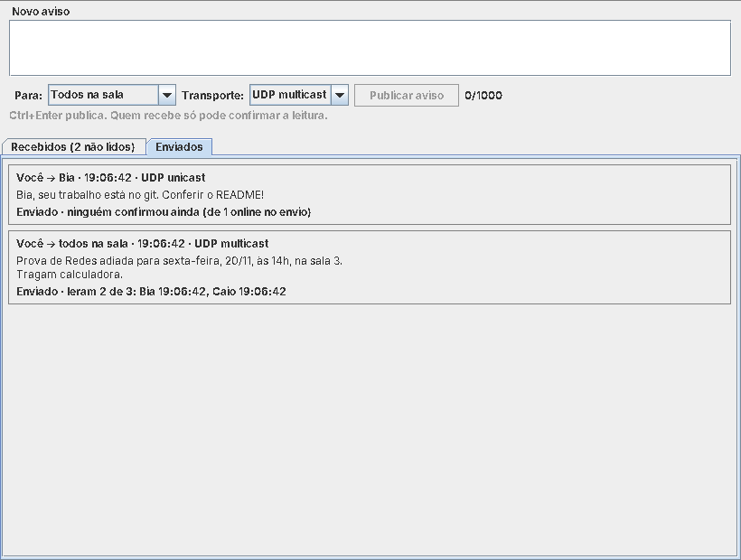

# Mural — plugin de quadro de avisos para o Pitiupi

Uma pessoa publica um aviso (texto livre) para **a sala inteira** (comunicação em grupo) ou para
**uma pessoa** (unicast). Quem recebe **só pode confirmar a leitura**; o autor acompanha quem já leu.

- Autor(a): Guilherme Ulhoa Cintra de Sousa
- Identificador: `pitiupi.mural` · Nome na galeria: **Quadro de avisos** · Versão 1.0.0
- Java 17, projeto Ant (mesma casca do plugin `chat`). Não abre socket: envia pelo `MessageDispatcher` do núcleo.

| Recebidos | Enviados |
| --- | --- |
|  |  |

## Como compilar e rodar

Na raiz do clone (o `plugins.registry.json` já tem a entrada `mural`):

```bash
./scripts/pitiupi.sh run --plugins chat,mural
```

Só o plugin: `cd pitiupi && ant jar` (núcleo) e depois `cd plugins/mural && ant jar`.
Depois do login (mesma porta nos dois computadores, ex. 5000): aba **Plugins → Quadro de avisos**,
ou clique numa pessoa da lista → **Enviar aviso para esta pessoa**; na linha **Todos** →
**Publicar aviso para todos**.

## Como usar

1. Escolha **Para:** *Todos na sala* ou uma pessoa online, e o **Transporte**.
2. Escreva o texto (até 1000 caracteres) e clique **Publicar aviso** (ou Ctrl+Enter).
3. Quem recebe vê o aviso em **Recebidos** (borda azul = não lido) e clica **Confirmar leitura**.
4. Em **Enviados** o autor vê "leram 2 de 3: Bia 19:06, Caio 19:06".

Transportes oferecidos (catálogo do núcleo):

| Destino | Opções |
| --- | --- |
| Sala | UDP multicast (um datagrama para `224.0.0.3`); UDP unicast (uma cópia por pessoa online); TCP (uma conexão por pessoa) |
| Uma pessoa | UDP unicast; TCP |

## Protocolo

Dois tipos de mensagem, ambos subclasses de `pitiupi.models.Messages.Message` (serialização Java do núcleo),
declaradas em `getMessages()`. Versão atual do protocolo: **1** (`AvisoMessage.PROTOCOL_VERSION`).

### `AVISO` (`AvisoMessage`) — autor → destinatário(s)

| Campo | Significado |
| --- | --- |
| `version` | versão do protocolo; receptor descarta versão desconhecida |
| `avisoId` | UUID do aviso |
| `authorId` | UUID gerado pelo plugin a cada execução (o `getIdentifier()` do núcleo é fixo, não serve) |
| `authorName`, `authorIp` | nome e IPv4 do autor (`LocalNetworkInfo.bestLocalIpv4()`) |
| `text` | texto, 1 a 1000 caracteres |
| `createdAtMillis` | horário do autor |
| `escopo` | `SALA` ou `PESSOA` |
| `transport` | nome do `TransportMode` usado (`MULTICAST_UDP`, `UNICAST_UDP`, `TCP`) |

### `LEITURA` (`LeituraMessage`) — leitor → autor

| Campo | Significado |
| --- | --- |
| `version`, `avisoId` | versão e aviso confirmado |
| `authorId` | autor do aviso; quem não é o autor descarta |
| `readerId` | UUID do leitor (chave de deduplicação) |
| `readerName`, `readerIp`, `readAtMillis` | quem leu e quando |

### Fluxo

```
Autor                                         Leitor(es)
  | -- AVISO (multicast | unicast | TCP) -----> |   leitor valida, guarda, mostra
  |                                             |   (pessoa clica "Confirmar leitura")
  | <---- LEITURA (unicast UDP, ou TCP) ------- |   só para authorIp
  | autor conta o readerId uma vez
```

### Regras

1. **Validação (receptor):** descarta `AVISO` sem `avisoId`/`authorId`/`authorIp`/`escopo`, com texto vazio
   ou maior que 1000, ou com `version` desconhecida. Descarta `LEITURA` sem `avisoId`/`authorId`/`readerId`.
2. **Eco:** `AVISO` cujo `authorId` é o próprio é ignorado (o multicast volta para quem enviou).
3. **Duplicata:** `AVISO` com `avisoId` já visto é ignorado.
4. **Só confirmar:** o protocolo não tem resposta, edição nem remoção. O único retorno possível é `LEITURA`.
5. **Transporte da confirmação:** TCP se o aviso chegou por TCP; caso contrário UDP unicast.
6. **UDP não garante entrega:** após o envio da `LEITURA` em UDP, ela é reenviada 1 s e 3 s depois. Por ser
   idempotente (autor ignora o mesmo `readerId` repetido), os reenvios são inofensivos. Em TCP não há reenvio.
7. **Autor:** `LEITURA` com `authorId` diferente do seu, ou de `avisoId` desconhecido, é ignorada.
8. **Falha na confirmação:** se o núcleo não conseguiu enviar, o aviso continua "não lido" e a pessoa pode tentar de novo.
9. **Sem travar a interface:** todo envio roda numa thread própria (TCP pode levar até 5 s para conectar).
10. **Segurança de exibição:** o texto vem da rede e é mostrado como texto puro (nunca HTML).

## Limitações

- Quem entra na sala depois não vê avisos antigos; nada é gravado em disco.
- O núcleo não informa o IP de origem ao plugin; por isso o autor envia o próprio IP na mensagem. Com mais de
  uma placa de rede, a confirmação pode ir ao endereço errado.
- "Leram X de N": N é o número de pessoas online no momento do envio (estimativa).
- Sem autenticação nem criptografia (característica do núcleo): qualquer um pode usar outro nome.
- Todos precisam do mesmo JAR do mural (classes diferentes quebram a desserialização).

## Testes

```bash
cd plugins/mural
ant selftest          # 63 verificações do protocolo, sem JUnit
sudo ./selftest/e2e.sh   # ponta a ponta com o núcleo real, 2 processos (Linux, root, iproute2)
```

`e2e.sh` roda 5 cenários (sala e pessoa × multicast/unicast/TCP) em dois namespaces de rede ligados por um cabo
virtual. `UiPreview` gera as imagens de `docs/` (precisa de display, ex. `xvfb-run`).

## Estrutura

```
plugins/mural/
├── build.xml, nbproject/            projeto Ant (alvo extra: selftest)
├── src/META-INF/services/pitiupi.models.Plugin   → pitiupi.mural.plugin.MuralPlugin
├── src/pitiupi/mural/net/           AvisoMessage, LeituraMessage, Escopo
├── src/pitiupi/mural/control/       MuralController (regras), modelos, MuralSender/CoreMuralSender
├── src/pitiupi/mural/GUI/           MuralPanel
├── src/pitiupi/mural/plugin/        MuralPlugin
└── selftest/                        testes, e2e.sh, UiPreview
```
